<p align="center">
  
</p>

<p align="center">
  <a href="https://github.com/DevSerae/logwatch-dashboard-releases/releases/latest"></a>
  
  
  
</p>

<p align="center">
  <b>A self-hosted "what needs doing" board for homelabs and small networks.</b><br>
  Logs, API data and edge traffic come in. A short list of things to act on comes out.
</p>

<p align="center">
  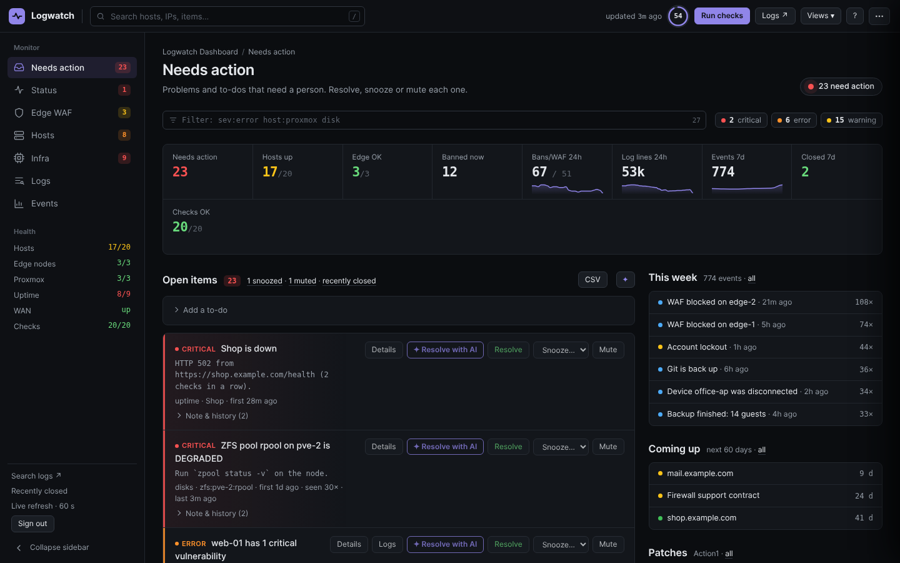
</p>

<p align="center">
  <a href="#-quick-start">Quick start</a> ·
  <a href="#-what-you-get">What you get</a> ·
  <a href="#-screenshots">Screenshots</a> ·
  <a href="#-prerequisites">Prerequisites</a> ·
  <a href="#-runs-on">Runs on</a> ·
  <a href="#-admin-commands">Admin commands</a> ·
  <a href="#-updates">Updates</a> ·
  <a href="#-uninstall">Uninstall</a>
</p>

---

## ⚡ Quick start

On the Linux VM that will host the board:

```bash
curl -fsSL https://github.com/DevSerae/logwatch-dashboard-releases/releases/latest/download/install.sh | sudo bash
```

That's it. The script installs what's missing (it **asks** before installing Docker), puts the board in
`/opt/logwatch-dashboard` and starts the web setup on the board's port. Open the link it prints (it carries a one-time
token); when you're done, the same page turns into the board at `http://<vm>:8080`.

<details>
<summary><b>Prefer to read it first?</b> (recommended)</summary>

```bash
curl -fsSLO https://github.com/DevSerae/logwatch-dashboard-releases/releases/latest/download/install.sh
less install.sh
sudo bash install.sh            # --dir <path> · --version <x.y.z> · --yes · --no-setup
```

Or download the tarball from [Releases](https://github.com/DevSerae/logwatch-dashboard-releases/releases/latest),
check it against `SHA256SUMS`, unpack and run `sudo bash logwatch-dashboard/install.sh`.
</details>

<details>
<summary><b>Let your AI agent do it</b> (Claude Code, CloudCLI, Codex, Gemini CLI, OpenCode…)</summary>

Give the agent a shell on the board VM (and SSH to the servers it should set up), then say:

> Install Logwatch Dashboard from https://github.com/DevSerae/logwatch-dashboard-releases: run its install.sh with
> `--no-setup`, then follow AGENT_INSTALL.md in /opt/logwatch-dashboard.

The playbook makes it interview you first, ask before touching any machine, keep secrets out of the chat, and give you
an undo line for everything it installs.
</details>

## ✨ What you get

**🧾 The board, always on.** One list of things that need a person, each with history, notes, snooze, mute and
resolve. Also: an **Events** timeline, a **Hosts** view of log ingest per host, a **Logs** explorer on VictoriaLogs
(any query can become an alert rule), maintenance windows that silence what they cover, GeoIP, and updates you approve. **Users** come as
admins or view-only auditors, with MFA and sign-in through Google, Microsoft, Discord, GitHub or any OpenID Connect provider.

Everything else is a **module**. The setup groups modules into **monitors**; pick only what you use. A module that's
off runs no collectors, makes no outbound calls and needs no secrets.

### 🔎 Logs

| Module | Turn it on and you get |
|---|---|
| **Syslog intake** (on by default) | Linux hosts and network gear push syslog (TCP/UDP). Alerts for hosts that go silent, SSH brute force, new logins and your own log rules |
| **SSH pull** | The same for hosts that can't push: the board pulls their journal over SSH every minute |
| **Windows events** | Failed logons, service crashes, disk/NTFS errors, reboots and a heartbeat from Windows hosts via Fluent Bit; optional DNS top domains |
| **Alert file** | Picks up alerts another system already writes as JSON lines (SMB share or local file) |
| **Webhook** | `POST /api/ingest`: scripts, Uptime Kuma, Grafana or cron jobs raise and clear items |

<p align="center">
  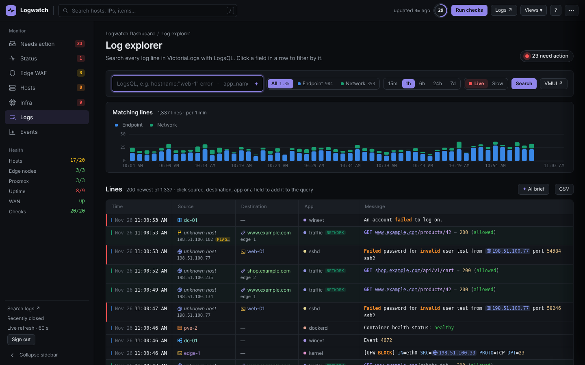
</p>

### 🛡️ Edge WAF

| Module | Turn it on and you get |
|---|---|
| **CrowdSec** | A health card per edge host (engine, LAPI, AppSec, bouncer), bans and WAF blocks, repeat offenders, Ban/Unban from the board |
| **Request / connection log** | Every HTTP request (Nginx Proxy Manager / nginx) and every new connection (nftables) through your edge, on a world map with filters |
| **Edge WAF** | Custom layer-7 rules from a rule builder, IP/CIDR bans with expiry, country/ASN rules, OWASP CRS level, **port proxies** for raw TCP/UDP services, named port/IP **lists** you can reuse in rules, and optional rule suggestions, auto-escalation, honeypot traps and bad-bot UA blocking (all off until you turn them on). Every change starts log-only, can be simulated against the last 24 h of traffic, and can be undone. Optional push to Cloudflare |

<p align="center">
  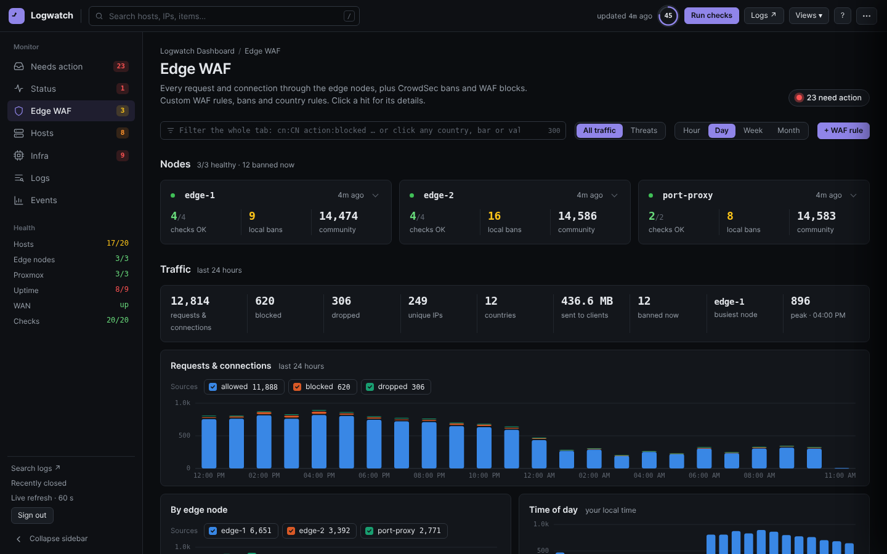
</p>

### 📡 Network

| Module | Turn it on and you get |
|---|---|
| **UniFi** | IPS/IDS alerts, firewall flows, gateway events and WAN health |
| **NetFlow / IPFIX** | Flows from any NetFlow v5/v9/IPFIX exporter |

### 🖥️ Hosts

| Module | Turn it on and you get |
|---|---|
| **Action1** | Missing patches and reboot-pending endpoints, per host |
| **Wazuh** | Agent status, SCA score, critical/high vulnerabilities and alerts merged into Hosts; alerts into Logs |
| **Container image CVEs** | A weekly Trivy scan of the images your containers run, with alerts for fixable HIGH/CRITICAL CVEs |

<p align="center">
  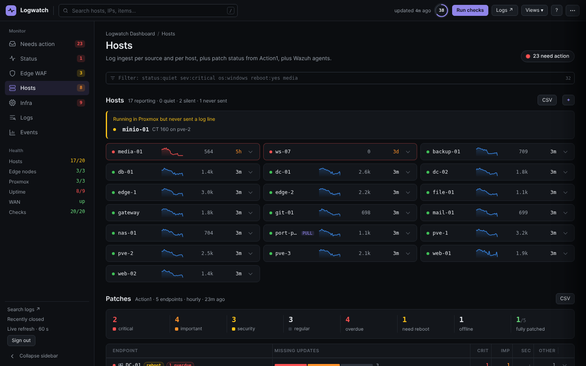
</p>

### ⏱️ Services

| Module | Turn it on and you get |
|---|---|
| **Uptime** | A Status tab with HTTP(S)/TCP probes every minute and response-time history. Add checks right on the tab |
| **Expiry** | TLS certificates, domain registrations (RDAP) and manual dates, warned about ahead of time |

<p align="center">
  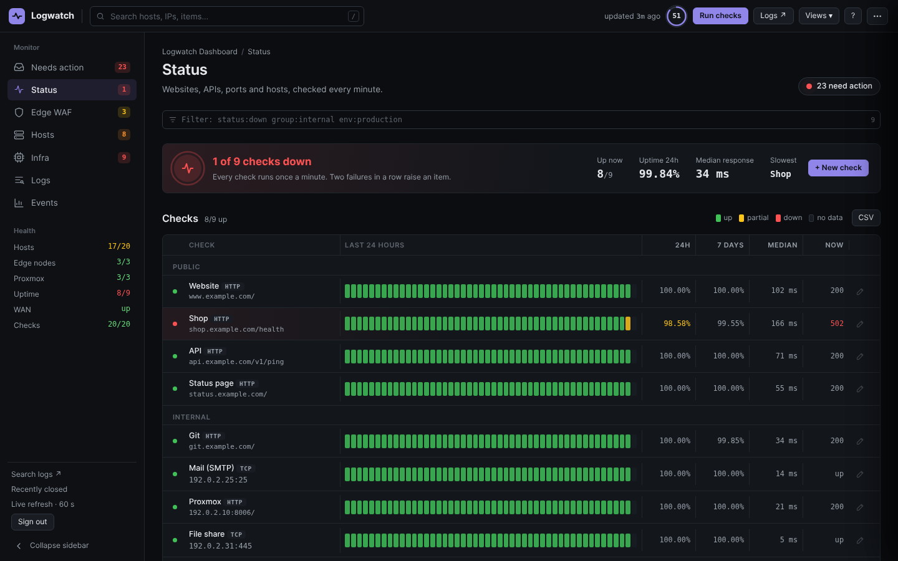
</p>

### 🏗️ Infra

| Module | Turn it on and you get |
|---|---|
| **Proxmox VE** | Nodes, guests, storage, backup freshness per guest, SMART and ZFS health, guests that never sent logs. In the setup, **Discover** fills every host list from your cluster |

<p align="center">
  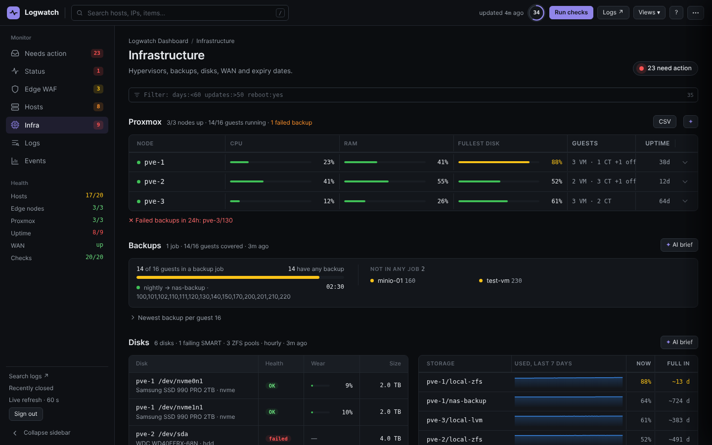
</p>

### 🧪 Extras

| Module | Turn it on and you get |
|---|---|
| **Instatus** | Board maintenance windows also post and resolve maintenance on your Instatus page |
| **Resolve with AI** | Your agent CLI (Claude Code, Codex, Gemini, OpenCode) works an incident while you watch the live transcript on the board |

## 📸 Screenshots

All screenshots are from a demo board with made-up data.

<details>
<summary><b>More of the board</b></summary>
<br>
<p align="center">
  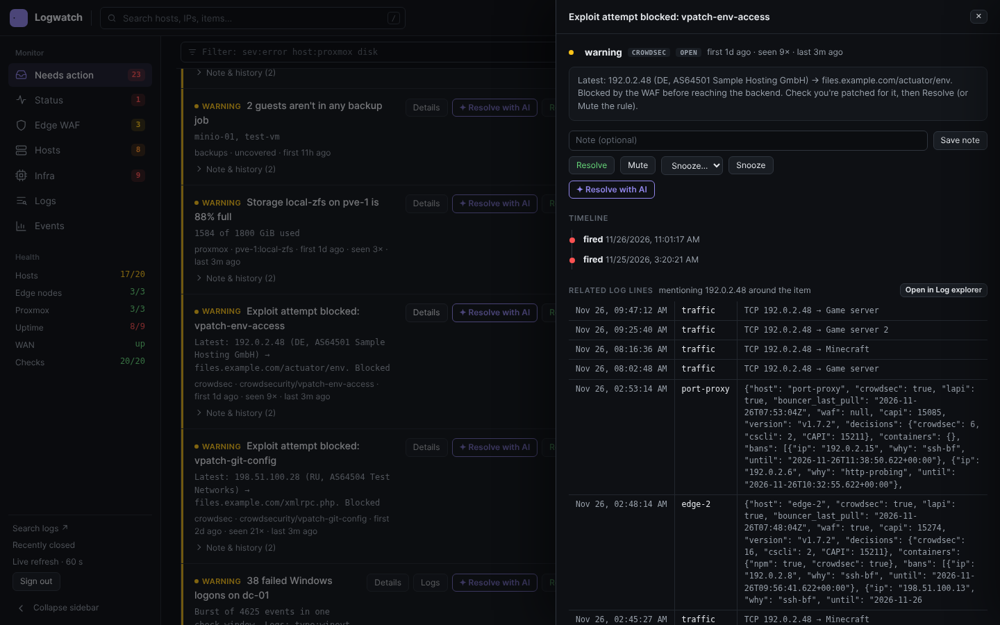<br><br>
  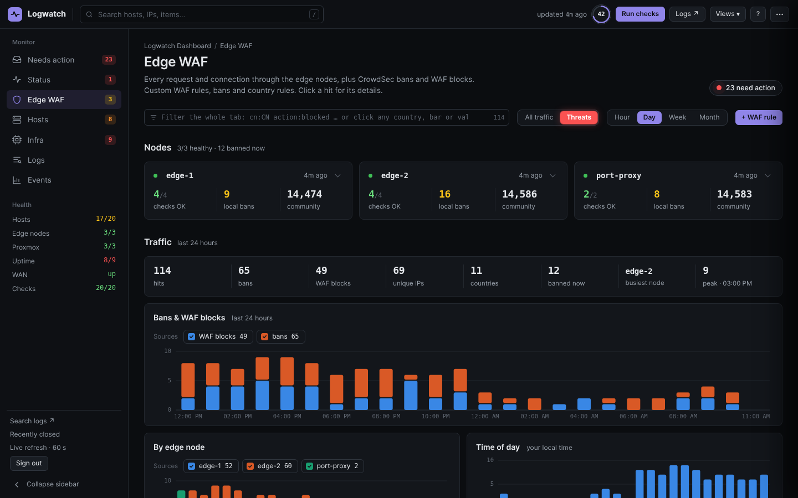<br><br>
  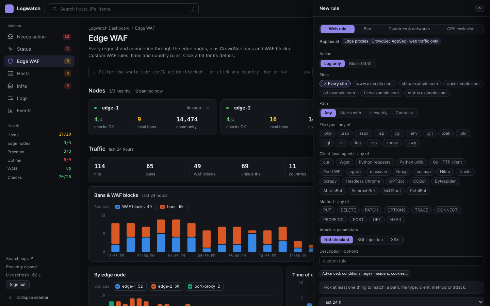<br><br>
  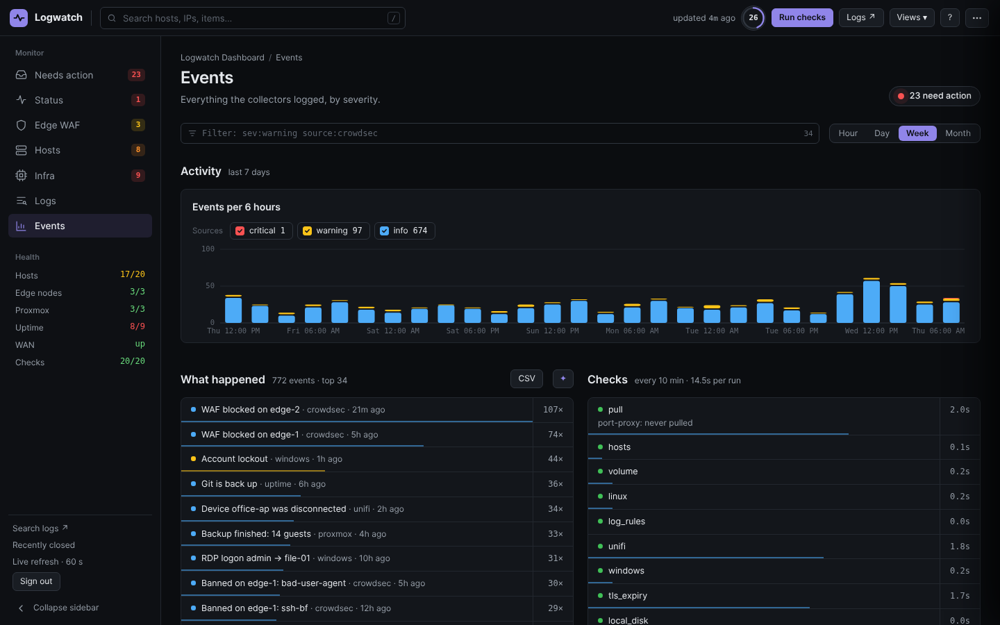<br><br>
  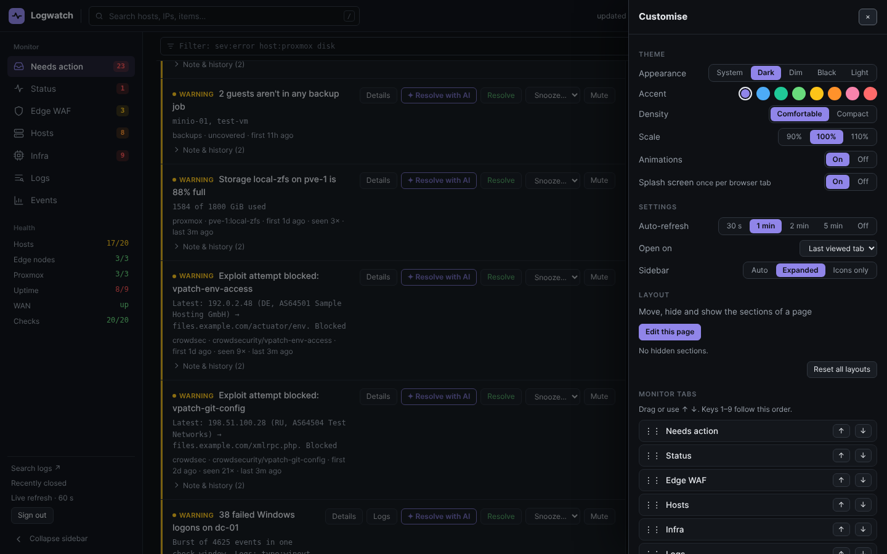<br><br>
  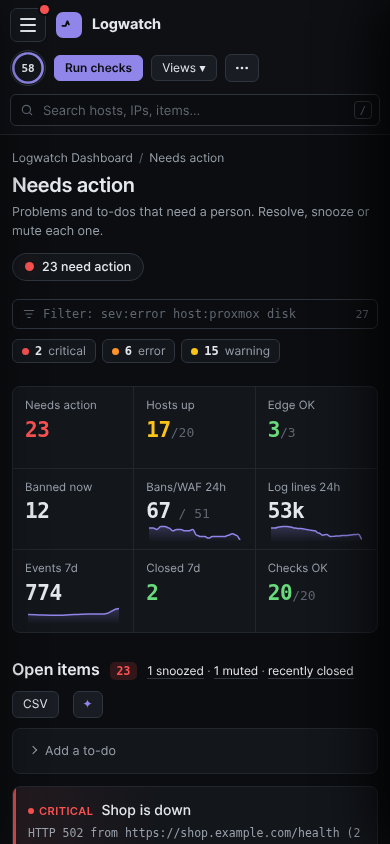
</p>
</details>

## 🧭 The web setup

Five steps in your browser, everything optional, every feature expands to exactly the inputs it needs. It runs on the
board's port behind a one-time token from the terminal and hands the port to the board when it's done.

| | |
|---|---|
| **1 · Board** | Port, login, who may reach the board, retention, GeoIP, updates |
| **2 · Access** | How this VM reaches your servers: direct, **Tailscale**, **NetBird**, **Cloudflare One** or another VPN. Lists exactly which ports and paths must be open, can install and join Tailscale/NetBird for you, and tests every server you enter |
| **3 · Features** | Turn areas and sources on, each with its inputs, steps and live checks. With Proxmox, **Discover** finds your nodes, VMs and containers |
| **4 · Servers** | Only what your picks need on each server. **Without AI**: one copy-paste line per server. **With AI**: a prompt to paste into any AI agent (Claude Code, CloudCLI, Codex, Gemini, OpenCode…), on the VM or anywhere that reaches your servers; it must ask you for access to every server and show every command first |
| **5 · Install** | Run every check, save, build and start; the page turns into the board's login |

Turn on more features later from the board's **Settings → Install features**; only the new pieces show up.

<p align="center">
  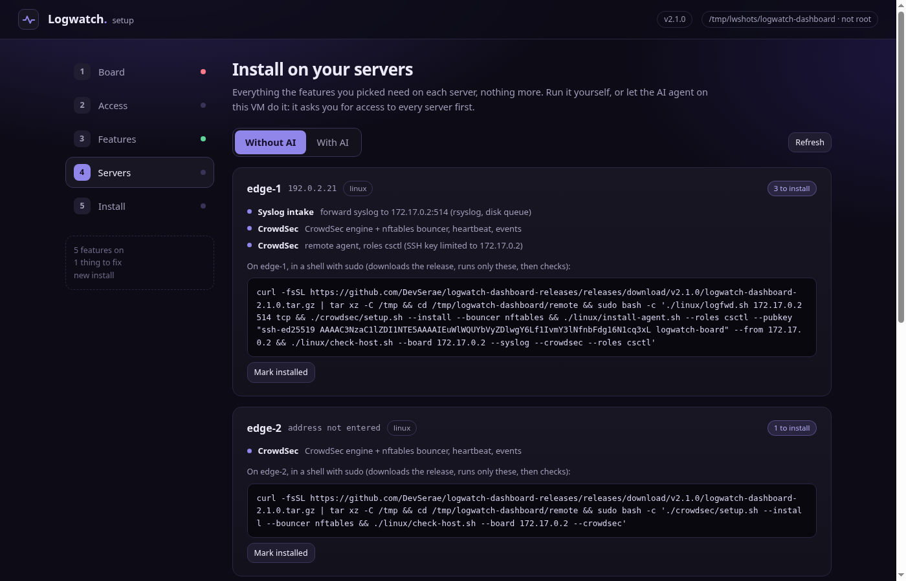
</p>

<details>
<summary><b>More screenshots</b></summary>
<br>
<p align="center">
  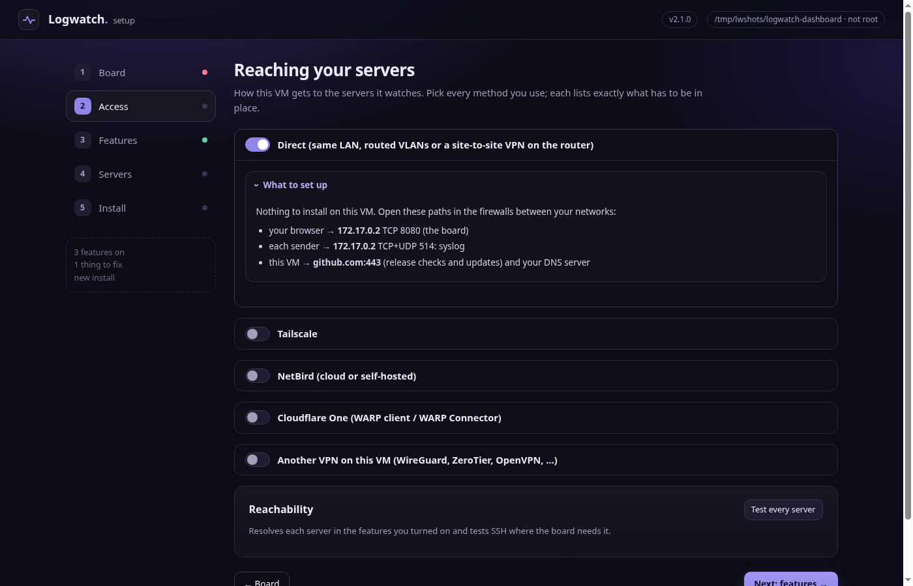<br><br>
  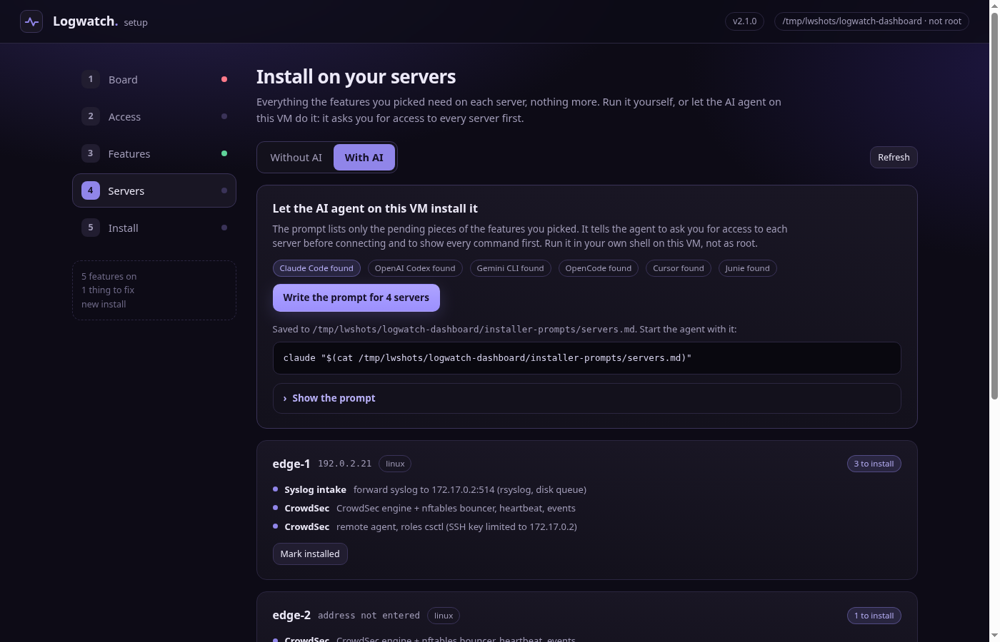
</p>
</details>

## 📋 Prerequisites

| | Minimum | Notes |
|---|---|---|
| **CPU / RAM** | 2 vCPU · 2 GB | 4 GB if you enable many modules or keep long retention |
| **Disk** | ~30 GB | logs are capped at 20 GB by default (30 days) |
| **Docker** | Engine 24+ with Compose v2 | `install.sh` offers to install it from get.docker.com |
| **Python** | 3.9+ | for the installer and `setup.py`; `python3-venv` is installed if missing |
| **systemd** | recommended | needed for one-click updates from the board |
| **Network** | outbound HTTPS | GitHub (updates), GeoIP downloads, the APIs you enable |
| **Reachability** | board ⇄ servers | SSH out to pulled hosts; syslog/NetFlow in from senders. LAN, VPN or overlay all fine |
| **Firewall** | Docker can forward | if the VM's firewall drops forwarded traffic, allow Docker's bridges out or the containers can't reach anything |

API access is read-only wherever the vendor allows it (Proxmox PVEAuditor, UniFi read-only key, Wazuh readonly role…).

## 🐧 Runs on

| Platform | Status |
|---|---|
| **Debian 13** (trixie) | ✅ Tested |
| **Debian 12** (bookworm) | ✅ Tested |
| Ubuntu 22.04 / 24.04 LTS | 🟡 Should work, untested |
| Rocky Linux / AlmaLinux 9, RHEL 9 | 🟡 Should work, untested (dnf) |
| Fedora (current) | 🟡 Should work, untested (dnf) |
| Proxmox LXC container | 🟡 Should work, untested: enable **nesting** (and **keyctl** for unprivileged CTs) |
| arm64 (Raspberry Pi 4/5, Ampere…) | 🟡 Should work, untested |
| Arch, Alpine, openSUSE, others | ⚙️ Manual: install Docker + Compose and Python 3.9+ yourself, then run `install.sh` |
| macOS, Windows, WSL | ❌ Not supported |

A VM is the smoothest option. Running the board on a Proxmox host itself isn't recommended: use a VM or CT.

## 🌐 Remote servers

Not everyone's network looks the same, so the installer asks instead of assuming:

| Way | What the installer does |
|---|---|
| **Direct** (same LAN, routed VLANs, site-to-site VPN) | nothing to install; tests the routes and SSH ports |
| **Tailscale** | installs and joins this VM with a one-off auth key (never stored); explains ACLs and subnet routers |
| **NetBird** | installs and joins with a setup key, self-hosted management URL supported; explains policies and routes |
| **Cloudflare One** | WARP client steps with headless service-token enrolment and private network routes |
| **Other** (WireGuard, ZeroTier, OpenVPN…) | checks the interface and shows which one reaches each server |

## 🔧 Admin commands

Run these on the board's VM, from the install directory. Run `setup.py` as the `logwatch` user (as root, 2.3.0+ keeps
`secrets/secrets.env` readable by the board, but files it creates elsewhere may not be).

```bash
cd /opt/logwatch-dashboard
```

### Users, roles and sign-in

Since 2.3.0 the board has **multiple users**, each with a role:

- **admin**: everything, including users and sign-in settings.
- **auditor**: view only. They can open every page and log but can't change anything. They can still manage their own
  password and MFA.

In the board, **Settings → Account** has your password, MFA and sessions. Admins also get **Users & sign-in** (`/users`)
for users, required MFA and SSO. The same tasks work from the VM with `setup.py user`, which runs inside the board
container. Changes apply at once, with no restart. None of these commands need the old password, so they also work
when you're locked out.

| Task | Command |
|---|---|
| List users | `sudo -u logwatch python3 setup.py user list` |
| Add a user (prompts for the password) | `sudo -u logwatch python3 setup.py user add alice --role auditor` |
| Add an SSO-only user | `sudo -u logwatch python3 setup.py user add bob --role admin --email bob@example.com --no-password` |
| Change a password | `sudo -u logwatch python3 setup.py user passwd alice` |
| Change the role | `sudo -u logwatch python3 setup.py user role alice admin` |
| Set the e-mail used for SSO | `sudo -u logwatch python3 setup.py user email alice alice@example.com` |
| Rename | `sudo -u logwatch python3 setup.py user rename alice alice.smith` |
| Disable, enable or delete | `sudo -u logwatch python3 setup.py user disable alice` (`enable`, `delete`) |
| Reset MFA (lost phone) | `sudo -u logwatch python3 setup.py user mfa-reset alice` |
| Sign one user out everywhere | `sudo -u logwatch python3 setup.py user signout alice` |
| Require MFA for password sign-in | `sudo -u logwatch python3 setup.py user policy --mfa-required on` |
| Locked out: reset the admin | `sudo -u logwatch python3 setup.py set-password` (keeps the current admin name; `--user NAME` creates or resets that admin) |
| Sign everyone out | `sudo -u logwatch python3 setup.py secret SESSION_SECRET --generate`, then `sudo docker compose restart board` |
| All options | `sudo -u logwatch python3 setup.py user --help` |

Passwords need at least 12 characters, and the commands read them from a prompt or from stdin, never from arguments.
For scripts, use `printf '%s\n' "$PW" | sudo -u logwatch python3 setup.py user passwd alice --stdin`. The board won't
demote, disable or delete the last admin.

**MFA**: in Settings → Account → Set up MFA, scan the QR code with any authenticator app (Google or Microsoft
Authenticator, 1Password, Bitwarden, Aegis…). You get 10 one-time recovery codes. With *Require MFA* on, users who
sign in with a password must set up MFA before they can do anything else. SSO sign-ins rely on the provider's own MFA.

#### Single sign-on (Google, Microsoft, Discord, GitHub, OpenID Connect)

1. In **Users & sign-in → Board URL**, set how users open the board, e.g. `https://logwatch.example.com`. You can also
   run `setup.py user policy --url https://logwatch.example.com`.
2. Under **Single sign-on**, pick the type. The form shows the redirect URI, `https://logwatch.example.com/auth/sso/<id>/callback`,
   and a link to that provider's console.
3. Create an OAuth app there with that redirect URI, then paste its client ID and secret into the form.
   - **Google**: Cloud console → APIs & Services → Credentials → OAuth client ID (Web application).
   - **Microsoft**: Entra ID → App registrations. Set *Tenant* to your directory ID or domain. Multi-tenant
     (`common`) isn't allowed.
   - **Discord**: Developer Portal → your application → OAuth2. Discord e-mails count only when they're verified.
   - **GitHub**: Settings → Developer settings → OAuth Apps. The board uses the account's verified e-mails.
   - **OpenID Connect** (Authentik, Keycloak, Authelia, Zitadel…): the issuer URL, i.e. the part before
     `/.well-known/openid-configuration`.
4. A provider signs in a board user whose **e-mail** matches the verified e-mail it reports. Set that e-mail on each
   user, or turn on **auto-create** with a role and, ideally, your e-mail domains.

From the VM: `printf '%s\n' "$SECRET" | sudo -u logwatch python3 setup.py user sso add --kind google --client-id ID`,
plus `sso list`, `sso off ID` and `sso remove ID`.

Who can reach the login is set in `config/config.yaml` under `board:`: `allow_cidrs` (only these networks),
`open_cidrs` (these skip the login and get `open_role`), `session_hours`, and `cf_access` for Cloudflare Access. An
Access user whose e-mail matches a board user gets that user's role; anyone else gets `cf_access.role`. Both roles
default to `admin`, so set them to `auditor` if those visitors should only look.

### Secrets and modules

| Task | Command |
|---|---|
| Store or replace an API key / token | `sudo -u logwatch python3 setup.py secret PROXMOX_TOKEN` (prompts, never printed) |
| Generate a random token | `sudo -u logwatch python3 setup.py secret INGEST_TOKEN --generate` |
| List modules | `sudo -u logwatch python3 setup.py modules` |
| Turn modules on / off | `sudo -u logwatch python3 setup.py modules --enable uptime,expiry --disable netflow` |
| Check config and required secrets | `sudo -u logwatch python3 setup.py check` |
| Apply config changes | `sudo -u logwatch python3 setup.py render && sudo docker compose up -d --build && sudo docker compose restart board worker` |
| The board's SSH public key | `sudo -u logwatch python3 setup.py pubkey` |
| Env file for the AI runner | `sudo -u logwatch python3 setup.py runner-env --out runner.env --url https://logwatch.example.com` |

After editing `config/config.yaml` by hand, run the *Apply config changes* line. You can also turn on new features from
the board: **Settings → Install features**.

### Service

| Task | Command |
|---|---|
| Status | `sudo docker compose ps` |
| Follow the logs | `sudo docker compose logs -f board worker` |
| Restart | `sudo docker compose restart board worker` |
| Stop / start | `sudo docker compose stop` / `sudo docker compose up -d` |
| Update to a version now | `sudo ./update.sh --version 2.2.1` |
| Update logs | `/var/log/logwatch-update-<version>.log` |
| Backups made before each update | `/var/backups/logwatch-dashboard` (last 3) |

## 🔄 Updates

- The board checks this repo every 12 hours (turn it off with `updates.check: false`).
- When a release is out, it asks: **Update now**, **Schedule** for a time you pick, **Remind me tomorrow**, or
  **Skip this version**. Nothing changes until you click.
- Optional: tick *install new releases automatically* to get them at 03:00.
- The host helper (`update.sh` via systemd) downloads only from the repo set on the host, verifies `SHA256SUMS`, backs
  up code and config, rebuilds, and **rolls back** if the board isn't healthy within 3 minutes.

Manual update any time: run the one-liner again. Your config, secrets and data are never touched.

## 🔐 Security

- Users with roles (admin, auditor = view only), PBKDF2 password hashes, TOTP MFA with recovery codes, SSO (Google,
  Microsoft, Discord, GitHub, OpenID Connect) with PKCE, signed HttpOnly cookies, login lockout, optional `allow_cidrs`.
- The board's SSH key can only run one dispatcher on each host, which allows only the roles you enabled there and
  validates every argument.
- Containers run as an unprivileged user with config and secrets mounted read-only.
- Secrets live in `secrets/` (mode 600) on your VM and never leave it. VPN join keys are used once and never stored.

## 🧑‍💻 Source code

The full source is in this repo; each release tarball is built from it with `tools/release.sh`.

| Path | What |
|---|---|
| `app/` | board (FastAPI) + worker (collectors) |
| `installer/` | the web setup (stdlib HTTP server + one page) |
| `install.sh`, `update.sh` | installer bootstrap, host updater |
| `config/config.example.yaml` | every setting, commented; `setup.py init` copies it to `config/config.yaml` |
| `secrets/` | created by setup: `secrets.env` + the board's SSH key. **Never share it** |
| `data/` | board database, GeoIP files, SSH known_hosts |
| `remote/` | scripts for the machines being watched: Linux, CrowdSec, Windows |
| `ai-runner/` | optional "Resolve with AI" runner |
| `docs/` | network gear, reverse proxy, webhook, remote access |
| `setup.py` | init, password, secrets, modules, check, render |
| `tools/release.sh` | builds the release assets into `dist/` |

Run from a checkout instead of a release: `python3 setup.py wizard`, or step by step
`python3 setup.py init && python3 setup.py set-password`, edit `config/config.yaml`, then
`python3 setup.py check && python3 setup.py render && docker compose up -d --build`.

## 🧹 Uninstall

```bash
cd /opt/logwatch-dashboard && sudo docker compose down -v
sudo systemctl disable --now logwatch-update.path logwatch-update.timer
sudo rm -rf /opt/logwatch-dashboard /etc/systemd/system/logwatch-update.* /etc/default/logwatch-dashboard /var/backups/logwatch-dashboard
sudo userdel logwatch
```

Scripts installed on monitored hosts each print their own undo line in their header.

---

<p align="center"><sub>Releases only: this repo holds the installer and release assets.</sub></p>
