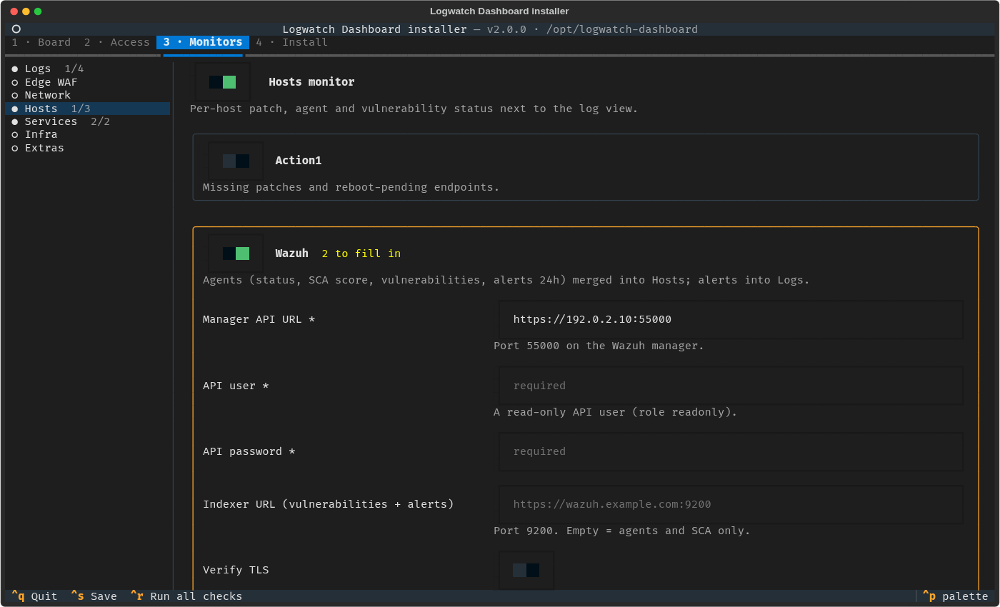
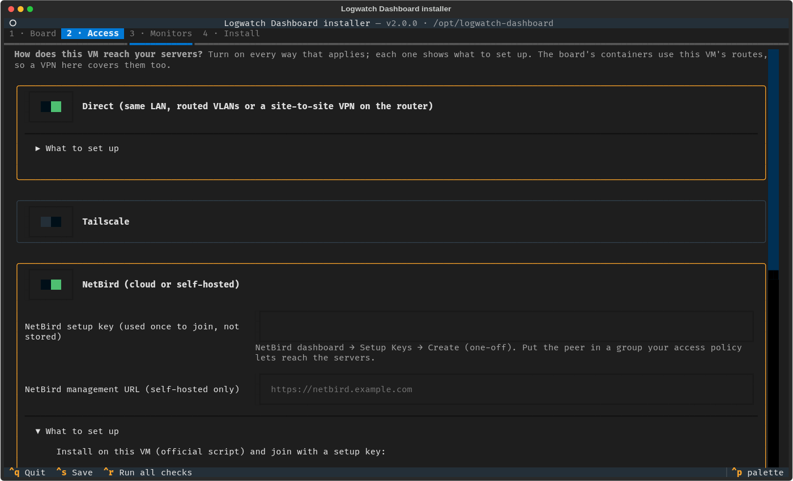
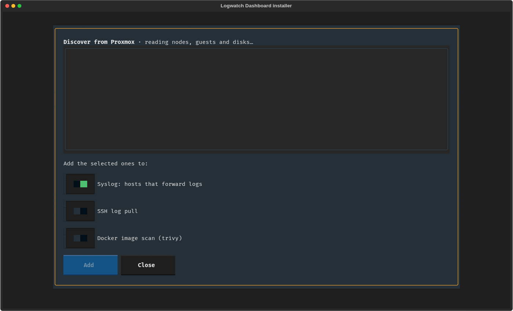

<p align="center">
  
</p>

<p align="center">
  <a href="https://github.com/DevSerae/logwatch-dashboard-releases/releases/latest"></a>
  
  
  
</p>

<p align="center">
  <b>A self-hosted "what needs doing" board for homelabs and small networks.</b><br>
  Logs, API data and edge traffic come in. A short list of things to act on comes out.
</p>

<p align="center">
  <a href="#-quick-start">Quick start</a> ·
  <a href="#-what-you-get">What you get</a> ·
  <a href="#-prerequisites">Prerequisites</a> ·
  <a href="#-runs-on">Runs on</a> ·
  <a href="#-updates">Updates</a> ·
  <a href="#-uninstall">Uninstall</a>
</p>

---

## ⚡ Quick start

On the Linux VM that will host the board:

```bash
curl -fsSL https://github.com/DevSerae/logwatch-dashboard-releases/releases/latest/download/install.sh | sudo bash
```

That's it. The script installs what's missing (it **asks** before installing Docker), puts the board in
`/opt/logwatch-dashboard` and opens a setup TUI that walks you through the rest. Then open `http://<vm>:8080`.

<details>
<summary><b>Prefer to read it first?</b> (recommended)</summary>

```bash
curl -fsSLO https://github.com/DevSerae/logwatch-dashboard-releases/releases/latest/download/install.sh
less install.sh
sudo bash install.sh            # --dir <path> · --version <x.y.z> · --yes · --no-tui
```

Or download the tarball from [Releases](https://github.com/DevSerae/logwatch-dashboard-releases/releases/latest),
check it against `SHA256SUMS`, unpack and run `sudo bash logwatch-dashboard/install.sh`.
</details>

<details>
<summary><b>Let your AI agent do it</b> (Claude Code, CloudCLI, Codex, Gemini CLI, OpenCode…)</summary>

Give the agent a shell on the board VM (and SSH to the servers it should set up), then say:

> Install Logwatch Dashboard from https://github.com/DevSerae/logwatch-dashboard-releases: run its install.sh with
> `--no-tui`, then follow AGENT_INSTALL.md in /opt/logwatch-dashboard.

The playbook makes it interview you first, ask before touching any machine, keep secrets out of the chat, and give you
an undo line for everything it installs.
</details>

## ✨ What you get

<table>
<tr>
<td width="50%" valign="top">

**🧾 One list of things to do**<br>
Hosts gone silent, SSH brute force, failed backups, expiring certificates, IPS and Wazuh alerts, CrowdSec bans, down
services, missing patches. Each item has history, notes, snooze/mute and optional **Resolve with AI**.

</td>
<td width="50%" valign="top">

**🛡️ Edge WAF**<br>
Every request and connection through your edge hosts on a world map. Custom layer-7 rules, IP/CIDR bans, country/ASN
rules, OWASP CRS levels and port proxies. Every change starts log-only and is undoable; optional push to Cloudflare.

</td>
</tr>
<tr>
<td valign="top">

**🔎 Logs explorer**<br>
Syslog (TCP/UDP), SSH journal pull, Windows event logs and NetFlow land in VictoriaLogs. Search them, and turn any
query into board items with custom rules.

</td>
<td valign="top">

**🖥️ Hosts, Infra, Services**<br>
Proxmox nodes, guests, backups, SMART and ZFS; Wazuh agents, SCA and vulnerabilities; Action1 patches; container image
CVEs; uptime probes; certificate and domain expiry.

</td>
</tr>
<tr>
<td valign="top">

**🧩 Everything is a module**<br>
Syslog is on by default; switch on only what you use: Proxmox, UniFi, Windows, NetFlow, CrowdSec, Wazuh, Action1,
Instatus, webhook, AI. Off means no collectors, no outbound calls, no secrets needed.

</td>
<td valign="top">

**🔄 Updates you approve**<br>
The board tells you when a release is out. Update now, schedule it, or skip it. A host helper verifies, backs up and
rolls back if the new version doesn't come up.

</td>
</tr>
</table>

## 🧭 The setup TUI

Four tabs, everything optional, every module expands to exactly the inputs it needs.

| | |
|---|---|
| **1 · Board** | Port, login, who may reach the board, retention, GeoIP, updates |
| **2 · Access** | How this VM reaches your servers: direct, **Tailscale**, **NetBird**, **Cloudflare One** or another VPN. It shows what to set up, can install and join Tailscale/NetBird for you, and tests every server you enter |
| **3 · Monitors** | Turn monitors and modules on. Each one has the steps for the target machines (or a prompt to paste into your AI agent) and live checks. With Proxmox, **Discover** finds your nodes, VMs and containers |
| **4 · Install** | Run every check, save, start the containers, wait for the board |

<p align="center">
  
</p>

<details>
<summary><b>More screenshots</b></summary>
<br>
<p align="center">
  <br><br>
  
</p>
</details>

## 📋 Prerequisites

| | Minimum | Notes |
|---|---|---|
| **CPU / RAM** | 2 vCPU · 2 GB | 4 GB if you enable many modules or keep long retention |
| **Disk** | ~30 GB | logs are capped at 20 GB by default (30 days) |
| **Docker** | Engine 24+ with Compose v2 | `install.sh` offers to install it from get.docker.com |
| **Python** | 3.9+ | for the installer and `setup.py`; `python3-venv` is installed if missing |
| **systemd** | recommended | needed for one-click updates from the board |
| **Network** | outbound HTTPS | GitHub (updates), GeoIP downloads, the APIs you enable |
| **Reachability** | board ⇄ servers | SSH out to pulled hosts; syslog/NetFlow in from senders. LAN, VPN or overlay all fine |

API access is read-only wherever the vendor allows it (Proxmox PVEAuditor, UniFi read-only key, Wazuh readonly role…).

## 🐧 Runs on

| Platform | Status |
|---|---|
| **Debian 13** (trixie) | ✅ Tested |
| **Debian 12** (bookworm) | ✅ Tested |
| Ubuntu 22.04 / 24.04 LTS | 🟡 Should work, untested |
| Rocky Linux / AlmaLinux 9, RHEL 9 | 🟡 Should work, untested (dnf) |
| Fedora (current) | 🟡 Should work, untested (dnf) |
| Proxmox LXC container | 🟡 Should work, untested: enable **nesting** (and **keyctl** for unprivileged CTs) |
| arm64 (Raspberry Pi 4/5, Ampere…) | 🟡 Should work, untested |
| Arch, Alpine, openSUSE, others | ⚙️ Manual: install Docker + Compose and Python 3.9+ yourself, then run `install.sh` |
| macOS, Windows, WSL | ❌ Not supported |

A VM is the smoothest option. Running the board on a Proxmox host itself isn't recommended: use a VM or CT.

## 🌐 Remote servers

Not everyone's network looks the same, so the installer asks instead of assuming:

| Way | What the installer does |
|---|---|
| **Direct** (same LAN, routed VLANs, site-to-site VPN) | nothing to install; tests the routes and SSH ports |
| **Tailscale** | installs and joins this VM with a one-off auth key (never stored); explains ACLs and subnet routers |
| **NetBird** | installs and joins with a setup key, self-hosted management URL supported; explains policies and routes |
| **Cloudflare One** | WARP client steps with headless service-token enrolment and private network routes |
| **Other** (WireGuard, ZeroTier, OpenVPN…) | checks the interface and shows which one reaches each server |

## 🔄 Updates

- The board checks this repo every 12 hours (turn it off with `updates.check: false`).
- When a release is out, it asks: **Update now**, **Schedule** for a time you pick, **Remind me tomorrow**, or
  **Skip this version**. Nothing changes until you click.
- Optional: tick *install new releases automatically* to get them at 03:00.
- The host helper (`update.sh` via systemd) downloads only from the repo set on the host, verifies `SHA256SUMS`, backs
  up code and config, rebuilds, and **rolls back** if the board isn't healthy within 3 minutes.

Manual update any time: run the one-liner again. Your config, secrets and data are never touched.

## 🔐 Security

- Single admin account, PBKDF2 password hashes, signed HttpOnly cookies, login lockout, optional `allow_cidrs`.
- The board's SSH key can only run one dispatcher on each host, which allows only the roles you enabled there and
  validates every argument.
- Containers run as an unprivileged user with config and secrets mounted read-only.
- Secrets live in `secrets/` (mode 600) on your VM and never leave it. VPN join keys are used once and never stored.

## 🧹 Uninstall

```bash
cd /opt/logwatch-dashboard && sudo docker compose down -v
sudo systemctl disable --now logwatch-update.path logwatch-update.timer
sudo rm -rf /opt/logwatch-dashboard /etc/systemd/system/logwatch-update.* /etc/default/logwatch-dashboard /var/backups/logwatch-dashboard
sudo userdel logwatch
```

Scripts installed on monitored hosts each print their own undo line in their header.

---

<p align="center"><sub>Releases only: this repo holds the installer and release assets.</sub></p>
